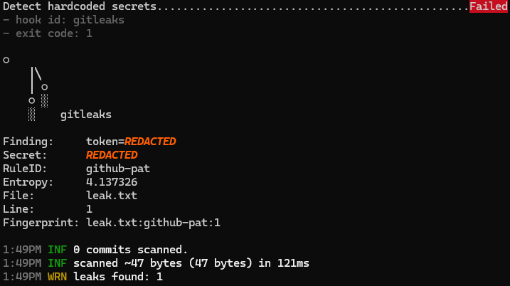

# repo-standards-template

## Scenario
Cox Automotive's release team supports 70+ service repos (Autotrader, KBB, Dealertrack), each set up differently. This template is the single starting point for every new repo.

## What's included
| File | Purpose |
|---|---|
| `.github/PULL_REQUEST_TEMPLATE.md` | What / why / how tested / rollback plan |
| `.github/ISSUE_TEMPLATE/bug.yml` | Structured bug form |
| `.github/CODEOWNERS` | Auto-request review |
| `.github/dependabot.yml` | Weekly pip, Docker, Actions updates |
| `.pre-commit-config.yaml` | Whitespace, large files, merge conflicts, ruff, hadolint, gitleaks |
| `.github/workflows/ci.yml` | Runs all hooks on every PR |
| `docs/ruleset.json` | Exported branch ruleset for `main` |

## Quick start
    gh repo create my-service --template razarizvi555/repo-standards-template --private --clone
    cd my-service && pre-commit install

## How to test
    make lint
    make test

## Break-fix drills
### 1. Gitleaks blocks a leaked token
Planted a fake GitHub PAT in `leak.txt` and tried to commit. The pre-commit gitleaks hook blocked it before it ever reached git history.

_More drills: merge conflict, revert, reflog recovery._

## Evidence
blocked-commit screenshot, ruleset.json, merged PR link.

## What I learned
Forgot to remove conflict markers before staging. The check-merge-conflict hook blocked the commit.
